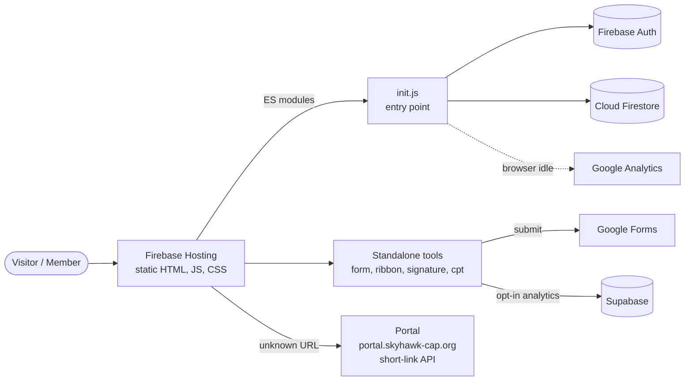

<div align="center">

# Skyhawk Composite Squadron Website

**Member portal and squadron tools for the Skyhawk Composite Squadron, Civil Air Patrol (Delano, MN)**

[](https://firebase.google.com/docs/hosting)
[](https://tailwindcss.com/)
[](#tech-stack)
[](LICENSE.txt)

[Live site](https://skyhawk-cap.org/) · [Release log](https://skyhawk-cap.org/changelog) · [Portal](https://portal.skyhawk-cap.org/) · [Contributing](CONTRIBUTING.md)

</div>

---

## Contents

- [Overview](#overview)
- [The Portal](#the-portal)
- [Routes](#routes)
- [Architecture](#architecture)
- [Tech stack](#tech-stack)
- [Project structure](#project-structure)
- [Getting started](#getting-started)
- [Configuration](#configuration)
- [Data model (Firestore)](#data-model-firestore)
- [Standalone tools](#standalone-tools)
- [How login and access work](#how-login-and-access-work)
- [Caching and performance](#caching-and-performance)
- [Releasing and deploying](#releasing-and-deploying)
- [Security notes](#security-notes)
- [Troubleshooting](#troubleshooting)
- [Known limitations](#known-limitations)
- [Contributing](#contributing)
- [License and credits](#license-and-credits)

---

## Overview

This repository is the source for **skyhawk-cap.org**. It is a **static site on Firebase Hosting**. Dynamic content comes from **Cloud Firestore**, and sign-in is handled by **Firebase Auth** (email and password).

The site is **member-first**. Visiting `/` redirects to `/member`, and anyone who isn't signed in is sent to `/login`. Photos live on a separate site, and everything that manages the site's data lives in the **[Portal](#the-portal)**, a separate project that is **not** part of this repo.

**What it provides**

| Area | What it does |
| --- | --- |
| **Member portal** | Dashboard of resource tiles (`/member`) and Firestore-driven content pages with side navigation (`/memberpage`). |
| **Cadet Calldown** | Weekly attendance form that opens and closes on a schedule and submits to a Google Form. |
| **Squadron tools** | Awards (ribbon rack) builder, CAP email signature editor, CyberPatriot competition display. |
| **Site controls** | Maintenance mode and a dismissible announcement banner, both switched from Firestore with no redeploy. |
| **Release log** | Searchable changelog viewer at `/changelog`, fed by a plain-text file. |
| **Short links** | Unknown URLs are checked against the Portal's link service and redirected if a short link exists. |

---

## The Portal

The **[Portal](https://portal.skyhawk-cap.org/)** (`portal.skyhawk-cap.org`) is the squadron's management hub. It is a separate project from this repo, and it is where everything this site displays is created and maintained. Members request access from its `/request-access` page (linked from the login screen).

| Portal area | What it manages | How this site uses it |
| --- | --- | --- |
| **Admin** | Users, access and site settings | Maintenance mode and the announcement banner (`admin/settings`); access requests from the login page |
| **Content management** | Member pages, menus and dashboard tiles | The `member/...` Firestore collections behind `/member` and `/memberpage` |
| **Stats** | Visit and page-view reporting | Reports on the counters this site writes (`userDailyVisits`, `pageMonthlyStats`) |
| **Calendar management** | Squadron events and schedule | Not displayed on this site yet (see [IMPROVEMENTS.md](IMPROVEMENTS.md)) |
| **Inspection scoring** | Entering and tracking inspection scores | Not displayed on this site yet (see [IMPROVEMENTS.md](IMPROVEMENTS.md)) |
| **More tools** | Short links and other squadron utilities | Short links resolve through the 404 page |

This repo only **reads** that data (plus the stats counters it writes). Anything on the Portal side needs changes in the Portal project, not here.

---

## Routes

Routing is defined in [`firebase.json`](firebase.json). "Member" routes are gated in the browser by `init.js` (see [How login and access work](#how-login-and-access-work)).

| Route | Serves | Access | Notes |
| --- | --- | --- | --- |
| `/` | 301 → `/member` | n/a | `index.html` is only a meta-refresh fallback. |
| `/login` | `login.html` | Public | Sign-in, password reset, first-time setup. |
| `/member` | `member.html` | Member | Dashboard of content boxes. |
| `/memberpage?page=<section>/<child>` | `memberpage.html` | Member | Content from Firestore. |
| `/form` · `/calldown` | `form.html` | Public | Same page, two URLs. |
| `/googleform?id=<id or URL>` | `googleform.html` | Public | Full-screen Google Form embed. |
| `/cpt` | `cpt.html` | Public | CyberPatriot competition display. |
| `/ribbon` | `ribbon.html` | Public | Awards builder. |
| `/signature` | `signature.html` | Public | Email signature editor. |
| `/changelog` · `/dev` | `changelog/index.html` | Public | Release log viewer. |
| `/app-info` · `/privacy-policy` | static pages | Public | Info pages for the Automation Script app. |
| `/health` | `health.json` | Public | Returns `{ "status": "ok" }` for uptime checks. |
| `/photos` | 301 → `photos.skyhawk-cap.org` | n/a | Photos are hosted separately. |
| `/admin` | the Portal | n/a | `https://portal.skyhawk-cap.org/` (see [Known limitations](#known-limitations)) |
| anything else | `/404` | Public | Checks for a short link, otherwise shows the 404 page. |

---

## Architecture



**How a page loads**

1. The HTML shell (`member.html`, `login.html`, ...) loads `config.js`, then dynamically imports `init.js` with `?v=<ASSET_VERSION>`.
2. `init.js` loads the critical CSS, then reads `admin/settings`. If maintenance mode is on, it renders a full-screen notice and stops.
3. Page modules are imported (all versioned), and non-critical scripts are loaded in the background.
4. For protected routes the page stays hidden until Firebase Auth reports a user. If there isn't one, the browser is sent to `/login`.
5. The modules for that route run in parallel. Menus, content boxes and pages render **from `localStorage` first**, then update if Firestore returns something different.

---

## Tech stack

| Layer | Technology |
| --- | --- |
| Hosting | Firebase Hosting (project `skyhawk-web`) |
| Data and auth | Cloud Firestore, Firebase Auth (Firebase JS SDK **12.7.0**, loaded as ES modules from `gstatic.com`) |
| Front end | HTML5, vanilla JavaScript modules, Tailwind CSS 3.4 |
| Legacy libraries | jQuery, jQuery Cycle2, and a vendored `main-*.min.js` bundle (loaded after the critical path) |
| Icons | Font Awesome 6.5 (member pages) |
| Tool back ends | Google Forms (calldown), Supabase (signature analytics), mcchord.org (ribbon builder) |
| Tooling | ESLint 9, Prettier 3, EditorConfig, Firebase CLI |

---

## Project structure

```text
skyhawk/
├── public/                     # Firebase Hosting root (everything here is deployed)
│   ├── index.html              # Meta-refresh fallback to /member
│   ├── login.html              # Sign in, reset, first-time setup
│   ├── member.html             # Member dashboard
│   ├── memberpage.html         # Firestore-driven member pages
│   ├── form.html               # Cadet Calldown (/form and /calldown)
│   ├── googleform.html         # Google Form embed
│   ├── cpt.html                # CyberPatriot competition display
│   ├── ribbon.html             # Awards builder
│   ├── signature.html          # Email signature editor
│   ├── edit.html               # Template for member page content (no route)
│   ├── app-info.html           # Automation Script info
│   ├── privacy-policy.html     # Automation Script privacy policy
│   ├── 404.html                # 404 page + short-link redirect
│   ├── changelog/
│   │   ├── index.html          # Release log viewer
│   │   └── CHANGELOG.txt       # Source of truth for release notes
│   ├── assets/
│   │   ├── js/                 # Site modules (see below)
│   │   ├── json/form.json      # Calldown questions
│   │   ├── images/
│   │   ├── easter/             # Hidden keyboard-triggered extras
│   │   └── manifest.json
│   ├── media/                  # PDFs, page images, content-box images
│   ├── styles.css              # Compiled Tailwind output (generated)
│   └── health.json · robots.txt · sitemap.xml · favicon.ico
├── src/input.css               # Tailwind input (base styles for page content)
├── tailwind.config.js          # Theme: CAP colours, dark mode, safelist
├── firebase.json · .firebaserc # Hosting, redirects, rewrites, cache headers
├── !Deploy.cmd                 # Guided Windows deploy script
├── .last-deployed-version      # Written by the deploy script
├── .github/workflows/          # PR preview deploys
├── package.json                # Lint and format scripts
├── eslint.config.js · .prettierrc.json · .editorconfig
└── CONTRIBUTING.md · LICENSE.txt · README.md
```

**`public/assets/js/` modules**

| File | Responsibility |
| --- | --- |
| `config.js` | Asset version, Firebase web config, analytics ID. **The one file you edit for settings.** |
| `init.js` | Entry point: Firebase init, maintenance check, asset loading, auth gate, per-route module list. |
| `public-settings.js` | Reads `admin/settings`; renders the maintenance screen and announcement banner. |
| `header-footer.js` | Renders the header and footer, and the dark-mode toggle. Unit name and designation are set here. |
| `menu.js` · `member-menu.js` | Desktop and mobile navigation from Firestore, cached in `localStorage`. |
| `content-boxes.js` | Dashboard tiles on `/member`. |
| `load-member-page.js` | Loads and renders `/memberpage` content (with sanitising) and the staff-diagram lightbox. |
| `login.js` | Sign-in, lockout, password reset, first-time flow. |
| `stats.js` | Per-user daily visit and per-page monthly view counters. |
| `mobile-menu-a11y.js` | Focus and keyboard behaviour for the mobile drawer. |
| `admin.js` | Shortcuts to the Portal (keyboard sequence, long-press on logo or copyright). |

---

## Getting started

### Prerequisites

- **Node.js 18.18+** (20 or newer recommended) and npm, for linting, formatting and Tailwind
- **Firebase CLI**: `npm install -g firebase-tools`, then `firebase login`
- Access to the `skyhawk-web` Firebase project (only needed to deploy)

### Run locally

```bash
git clone https://github.com/Ethan-html/skyhawk.git
cd skyhawk
npm install

# Serve public/ with the same redirects and rewrites as production
firebase emulators:start --only hosting
```

Open the URL the emulator prints. Because `/` redirects to `/member`, you will land on the login page.

> **Heads up:** `config.js` points at the **live** Firebase project, so local runs read production Firestore and use real accounts. Use a test project (edit `window.SITE_CONFIG.firebase`) if you need to experiment safely.

A plain static server (`npx serve public`) also works for quick HTML and CSS edits, but `/calldown`, `/health` and other rewrites will not resolve.

### Rebuild the CSS

Tailwind output is committed as `public/styles.css`. After changing classes in HTML or JS, or editing `src/input.css` or `tailwind.config.js`:

```bash
npx tailwindcss -i ./src/input.css -o ./public/styles.css --minify
```

### Lint and format

```bash
npm run lint           # ESLint over public/assets/js
npm run lint:fix
npm run format:check   # Prettier check
npm run format         # Prettier write
```

Style is enforced by [`.editorconfig`](.editorconfig) (2 spaces, LF) and [`.prettierrc.json`](.prettierrc.json) (100 columns, double quotes, semicolons, no trailing commas).

---

## Configuration

There are no environment variables on static hosting. Settings live in a few well-marked places.

### `public/assets/js/config.js`

| Setting | Purpose |
| --- | --- |
| `window.ASSET_VERSION` | Version string, `MAJOR.MINOR.PATCH`. Appended as `?v=` to every script and stylesheet to bust caches. The deploy script reads it. |
| `window.SITE_CONFIG.firebase` | Firebase web app config (`apiKey`, `projectId`, ...). |
| `window.SITE_CONFIG.measurementId` | Google Analytics 4 ID. Leave empty to disable analytics. |

### Site controls in Firestore (no redeploy)

Create or edit the document **`admin/settings`**:

| Field | Type | Effect |
| --- | --- | --- |
| `maintenanceMode` | boolean (`"true"` / `"1"` also accepted) | Replaces every page with a full-screen "We'll be right back" message. There is no bypass. |
| `announcementBanner` | string (HTML allowed) | Shows a dismissible "SPECIAL NOTICE" bar at the top of every page. Empty string hides it. |

Add `#public-settings-debug` to any URL to log the loaded values to the browser console.

### Calldown form

Questions live in `public/assets/json/form.json`. Timing lives in the `FORM_SETTINGS` block at the top of `form.html`.

| Setting | Meaning |
| --- | --- |
| `schedule.type` | `"weekly"`, `"date"`, `"close-only"` or `"always-open"`. |
| `schedule.open` / `close` | Day (0 = Sunday ... 6 = Saturday) and 24-hour time (`200` = 2:00 AM) for weekly mode. Current behaviour: **opens Tuesday 2:00 AM, closes Saturday at midnight.** |
| `schedule.closeDate` | `YYYY-MM-DDTHH:MM:SS`, used by `"date"` and `"close-only"`. |
| `schedule.closedBehavior` | `"close"` hides the form; `"skip"` keeps it usable but skips the drill-test step. |
| `deadlineText` / `closedMessage` | Text shown to cadets. Update these by hand when the schedule changes. |
| `FORM_CONFIG_VERSION` | **Bump whenever `form.json` changes** so browsers fetch the new copy. |
| `TEST_MODE` | Forces the clock to a Saturday for testing. **Must be `false` in production.** |

Each question in `form.json` maps to a Google Form field through its `googleId`, and answers are posted to the form's `formResponse` URL.

### Hard-coded in source

- **Unit name and designation:** `UNIT` in `header-footer.js`.
- **Footer links and credit line:** `header-footer.js`.
- **Theme:** colours, fonts and shadows in `tailwind.config.js`. Brand colours include `primary #001489`, `accent #ba0c2f` and the `capNavy` / `capBlue` / `capGold` set.

---

## Data model (Firestore)

All reads and writes use the Firebase client SDK. The structure below is what the code in this repo expects.

| Path | Fields | Used by | Read by |
| --- | --- | --- | --- |
| `admin/settings` | `maintenanceMode`, `announcementBanner` | `public-settings.js` | **Everyone**, including logged-out visitors |
| `member/menu/pages/{pageId}` | menu item fields (`title`, `url`, ...) | `menu.js`, `init.js` | Members |
| `member/menu/pages/{pageId}/children/{id}` | child menu item | `menu.js` | Members |
| `member/contentBoxes/children/{id}` | `title`, `url`, `img`, `target` | `content-boxes.js` | Members |
| `member/pages/children/{sectionId}` | `title` | `load-member-page.js` | Members |
| `member/pages/children/{sectionId}/children/{id}` | `title`, `slug`, `content` (HTML), `externalUrl` (optional) | `load-member-page.js` | Members |
| `userDailyVisits/{uid}` | `userId`, `date` (comma-separated `YYYY-MM-DD` list), `lastSeenAt` | `stats.js` | Written by the signed-in user |
| `pageMonthlyStats/{year}/{month}/{pageId}` | `pageUrl`, `year`, `month`, `viewCount`, `updatedAt` | `stats.js` | Written by any signed-in user |

**Notes**

- Dashboard tile images are loaded from `/media/website/content-boxs/` (the folder name really is spelled that way). `img` holds only the file name.
- Content pages are addressed as `/memberpage?page=<sectionId>/<childSlug>`. If the section document does not exist the visitor is sent to `/404`.
- `public/edit.html` is the **reference template** for the HTML structure used inside page content.
- The `main/` and `pages/` collections from earlier versions are no longer read by this repo's code.
- Content is edited through the [Portal](#the-portal), not in this repo.

---

## Standalone tools

These pages are mostly self-contained (inline JS, their own state) and do not need a login.

| Tool | Route | What it does |
| --- | --- | --- |
| **Cadet Calldown** | `/form`, `/calldown` | Multi-step form driven by `form.json`. Branches on the "attending?" answer, saves a draft in `localStorage`, and posts to a Google Form. |
| **Google Form embed** | `/googleform?id=` | Embeds a Google Form full-screen from a form ID or full URL. |
| **Awards builder** | `/ribbon` | Redesigned front end for the mcchord.org rack builder. Ribbon images and the form post go to `mcchord.org`. |
| **Email signature editor** | `/signature` | Builds CAP email signatures with copy-as-rich-text, HTML, mobile and plain-text options. Optional usage analytics are sent to Supabase and respect a consent check. |
| **CyberPatriot display** | `/cpt` | Competition-day screen: setup form (meet name, team ID in competition or training format, image key, coach email, duration), then a countdown that turns amber under 10 minutes and red under 1. Settings persist in `localStorage`. |
| **Release log** | `/changelog`, `/dev` | Searchable viewer for `changelog/CHANGELOG.txt`. |
| **Short links** | any unknown URL | `404.html` checks the Portal's link API (`/api/v1/links/<slug>`) and redirects when a link exists. |

There are also a few hidden, keyboard-triggered extras in `public/assets/easter/`. They load after the page is ready and are skipped inside iframes.

---

## How login and access work

1. **Gate.** For `/member` and `/memberpage`, `init.js` hides the page, waits for `onAuthStateChanged`, and redirects to `/login` when no one is signed in.
2. **Sign in.** `login.js` calls `signInWithEmailAndPassword`. After 5 failed attempts the form locks for 3 minutes (see [Security notes](#security-notes) for what this does and does not protect).
3. **First login.** If an account's `creationTime` equals its `lastSignInTime`, the app sends a password-reset email and signs the user out so they can choose their own password. Links with `?new=<email>` open a dedicated first-time screen.
4. **Reset.** "Forgot Password?" sends a reset email whose link returns to `https://skyhawk-cap.org/login`.
5. **Success.** The user is sent to `/member` and focus is moved to the main content area.
6. **Sign out.** The logout icon calls `signOut()` and returns to `/`.
7. **Tracking.** Signed-in page loads record a daily visit and a once-per-day-per-page view count (see [Data model](#data-model-firestore)).

Access to account creation is handled outside this repo (the login page links to the squadron's access-request portal).

---

## Caching and performance

| What | How |
| --- | --- |
| **Asset versioning** | `init.js` appends `?v=<ASSET_VERSION>` to its imports and to CSS and JS it loads. Bump the version to invalidate caches. |
| **HTTP caching** | `/assets/**`, `/media/**`, `/styles.css` and `main-*.js` are cached for 30 days. `config.js` is `no-cache`. |
| **Cache-first data** | Menus, content boxes and member pages render from `localStorage` instantly, then re-render only if Firestore data changed. |
| **Load tiers** | Critical CSS first; jQuery chain next; everything else in parallel; Google Analytics only when the browser is idle. |
| **Resilient init** | Page modules run with `Promise.allSettled`, so one failing module does not blank the page. |

`localStorage` keys in use: `menuPagesMember`, `contentBoxesChildren`, `memberPageData_<id>`, `theme`, `stats_state`, `cyberpatriot.display.*`. Clearing them is a safe first step when debugging stale content.

---

## Releasing and deploying

Every release is a version bump plus a changelog entry. The deploy script enforces the second part.

### Release checklist

1. Make and test your changes.
2. If `form.json` changed, bump `FORM_CONFIG_VERSION` in `form.html`.
3. Bump `window.ASSET_VERSION` in `public/assets/js/config.js`.
   `MAJOR` = breaking · `MINOR` = new features · `PATCH` = fixes only.
4. Add an entry to `public/changelog/CHANGELOG.txt` (format below).
5. Run `npm run lint` and `npm run format:check`.
6. Run **`!Deploy.cmd`** (Windows). It will:
   - confirm `config.js` and `CHANGELOG.txt` exist and the Firebase CLI is installed,
   - read the version and **block the deploy if `Version: X.Y.Z` is missing from the changelog**,
   - warn if the version matches `.last-deployed-version`,
   - run `firebase deploy`, and only then record the new version.
7. Commit using the version as the message, for example `V6.0.27`.

### Changelog entry format

```text
Version: 6.0.27
Date: Nov 15 2026
Name: Short title for this release

Added New thing that was added
Updated Something that changed
Fixed Something that was broken
```

Each line starts with one of `Added`, `Updated`, `Fixed`, `Changed`, `Removed`, `Security`, `Improved`, `Deprecated`, `Known` or `Note`. An optional link can be added in braces, for example `{https://skyhawk-cap.org/signature}`. See the `Version: 0.0.0` demo block at the top of the file.

### Continuous integration

[`firebase-hosting-pull-request.yml`](.github/workflows/firebase-hosting-pull-request.yml) deploys a **preview channel** for every pull request opened from this repository (not from forks). It needs the `FIREBASE_SERVICE_ACCOUNT_SKYHAWK_WEB` secret. Production deploys are done manually with `!Deploy.cmd`.

---

## Security notes

- **Firebase web config is public by design.** The values in `config.js` identify the project and are not secrets. Protection comes from Firestore rules, so keep the rules strict. Restricting the API key to the site's domains in Google Cloud is also recommended.
- **Firestore rules are not stored in this repo.** They live in the Firebase console, so any rules change is invisible to code review. Whatever you deploy must allow what the code does:
  - `admin/settings` **readable without login** (it is read before sign-in),
  - `member/**` readable by signed-in users only,
  - `userDailyVisits/{uid}` writable by that user,
  - `pageMonthlyStats/**` writable by signed-in users.

  <details>
  <summary>Reference rules sketch (compare with your live rules before changing anything)</summary>

  ```
  rules_version = '2';
  service cloud.firestore {
    match /databases/{database}/documents {

      // Maintenance flag and banner: read before login, so it must be public.
      match /admin/settings {
        allow read: if true;
        allow write: if request.auth != null && request.auth.token.admin == true;
      }

      // Member-only content (menus, content boxes, pages).
      match /member/{document=**} {
        allow read: if request.auth != null;
        allow write: if false;
      }

      // Per-user visit log.
      match /userDailyVisits/{uid} {
        allow read, write: if request.auth != null && request.auth.uid == uid;
      }

      // Monthly page counters (consider validating that viewCount only goes up by 1).
      match /pageMonthlyStats/{year}/{month}/{pageId} {
        allow create, update: if request.auth != null;
        allow read: if request.auth != null && request.auth.token.admin == true;
      }

      // Deny everything else.
      match /{document=**} {
        allow read, write: if false;
      }
    }
  }
  ```

  </details>

- **Route protection is client-side.** The HTML shell of `/member` is public. What protects the content is Firestore rules, so never put sensitive data in HTML files or `public/media`.
- **Login lockout is a courtesy, not a defence.** The 5-attempts-per-3-minutes counter lives in `sessionStorage`, so a new tab or private window resets it. Real throttling comes from Firebase Auth itself.
- **Member page HTML is sanitised with DOMPurify when `window.DOMPurify` exists.** See [IMPROVEMENTS.md](IMPROVEMENTS.md), because the library is not currently loaded by any page.
- **Cookies.** A `new` cookie remembers the first-time-login state. It is not used for access control.
- **Third-party keys in client code.** The Supabase key in `signature.html` is a *publishable* key and is safe only while row-level security and the `log_signature_event` function are locked down. Never commit a service-role or secret key.

---

## Troubleshooting

| Symptom | Likely cause and fix |
| --- | --- |
| Changes don't show after deploy | Browsers cached old files. Bump `ASSET_VERSION` and redeploy. |
| Deploy blocked: "NO COMMIT MESSAGE IN CHANGE LOG" | `CHANGELOG.txt` has no `Version: <ASSET_VERSION>` line. Add one. |
| Deploy warns about the same version | `ASSET_VERSION` equals `.last-deployed-version`. Bump it unless you really mean to redeploy. |
| Whole site shows "We'll be right back" | `admin/settings.maintenanceMode` is true. Set it to false. |
| Page stays blank on `/member` | Not signed in (should redirect to `/login`), or Firestore rules are blocking reads. Check the browser console. |
| Calldown shows "closed" at the wrong time | Check `FORM_SETTINGS.schedule` and make sure `TEST_MODE` is `false`. |
| Calldown shows old questions | Bump `FORM_CONFIG_VERSION` after editing `form.json`. |
| Menu or tiles look stale | Clear `menuPagesMember` / `contentBoxesChildren` from `localStorage`, or wait for the background refresh. |
| Styling looks broken after adding classes | Rebuild `styles.css` with the Tailwind command above. |

---

## Known limitations

- **Client-rendered.** Content is built in the browser, so it needs JavaScript.
- **Content model is coupled to the code.** Firestore structure is tied to the JS modules, so schema changes need code changes.
- **Management lives in the Portal.** Content, calendar, stats and inspection data are edited there, in a separate project with its own backend.
- **Windows-only deploy script.** `!Deploy.cmd` requires Windows and PowerShell.
- **Old Portal hostname in code.** `firebase.json` (`/admin`) and `404.html` (short-link lookup) still point at the former `admin.skyhawk-cap.org` host. Update them to `portal.skyhawk-cap.org` once the Portal's API is served from there.
- **Absolute production URLs.** A few assets (header images, changelog fetch) use `https://skyhawk-cap.org/...`, so local and preview builds still pull some files from production.

A prioritised list of fixes and improvements is in **[IMPROVEMENTS.md](IMPROVEMENTS.md)**.

---

## Contributing

Contributions are welcome. See [CONTRIBUTING.md](CONTRIBUTING.md) for the workflow.

Before opening a pull request:

- Run `npm run lint` and `npm run format:check`.
- Test the pages you touched: `/login`, `/member`, `/memberpage`, and any tool you changed. Check mobile and dark mode if you changed layout.
- Keep `ASSET_VERSION` bumps and changelog entries for release time, not every commit.

---

## License and credits

Released under a **CAP-members-only licence**. See [LICENSE.txt](LICENSE.txt) for the full terms. In short:

- Use is limited to Civil Air Patrol projects.
- The credit line in the footer (set in `header-footer.js`) **must stay visible** on all pages.
- The template may not be redistributed or sublicensed.

**Developed by Ethan Larson** (C/CMSgt Larson), Skyhawk Composite Squadron.

